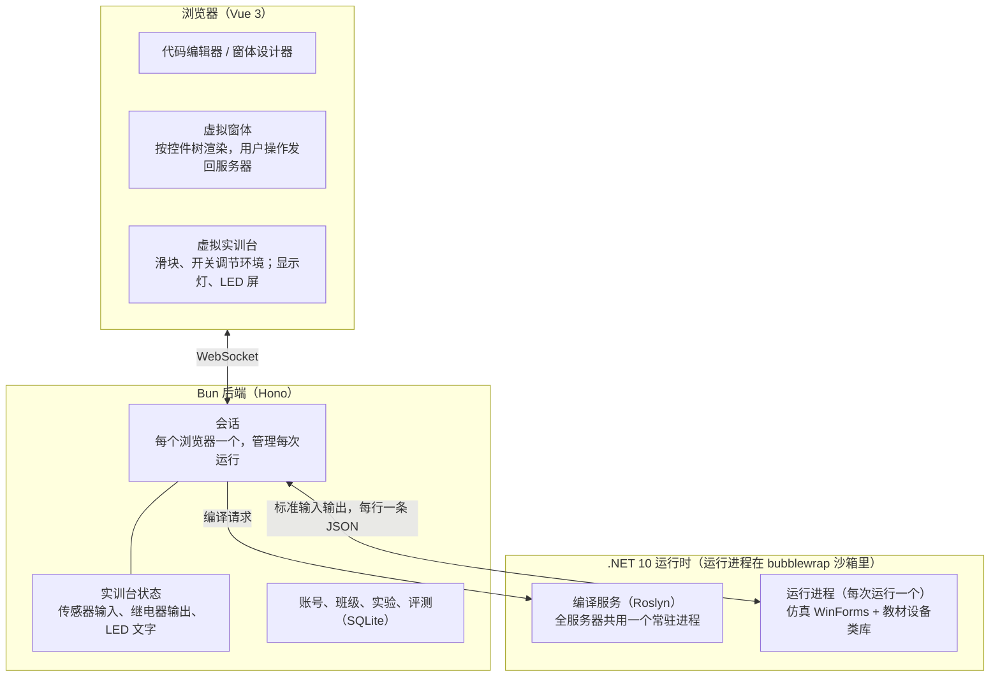
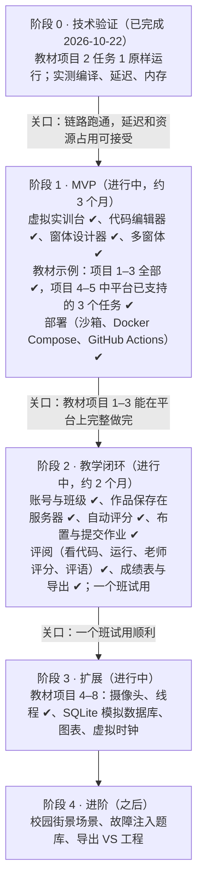

# 物联网 C# 虚拟仿真教学平台设计方案

> 本文件是设计方案的正式版本，随代码一起维护。最初在 Claude Docs 中讨论定稿（2026-10-20），2026-10-22 迁入仓库，并按第 0、1 阶段的实际实现更新。

## 项目定位与教学目标

这是一门面向中职学生的 **C# WinForms 界面与事件编程课**的在线仿真平台，物联网场景是让学生程序"看得见效果"的舞台。

- **学什么**：窗体、控件、属性、事件、Timer、条件判断、方法与类等界面编程知识。核心是"事件驱动"的思维：程序等待事情发生（点按钮、定时器到点、传感器报警），再做出反应。
- **教材**：《物联网编程与应用（第 2 版）》，以智慧校园为主线的 8 个项目。平台兼容教材的设备类库，教材代码原样可运行。
- **不学什么**：通信协议、报文、CRC，以及 ADAM-4150 / 4017+ 等硬件模块的底层细节。
- **效果**：学生写的程序能控制一个生动的智慧校园场景，比如 LED 屏显示文字、路灯亮起、有人闯入报警、烟雾告警，并能实时看到反馈。
- **使用方式**：纯网页，学生不安装任何软件；只给本校使用，同时在线约一两个班。

## 已确定的关键决策

| 事项 | 决定 | 理由 |
| --- | --- | --- |
| 学生编程语言 | C# | 课程要求 |
| 课程方向 | 上位机：WinForms 界面 + 事件 | 教学重点是界面和事件，不是协议 |
| 教材 | 《物联网编程与应用（第 2 版）》及配套资料 | 现用教材 |
| 实验模板与参考答案 | 以书为准，修正书中错误；配套工程只作参考 | 学生手里拿的是书 |
| 评测分工 | 功能项自动评；命名、缩进自动提示；注释和界面美观由老师评；分值由老师设定 | 书上评价表只有指标，没有分值 |
| 账号 | 老师只有一个账号（配置文件设定）；学生账号由老师上传 CSV 名单导入，密码由老师发放（可留空自动生成 6 位数字），学生不能改，老师能查看和重置 | 中职学生容易忘密码，老师能直接告诉学生 |
| 实验起点 | 布置作业时老师选：空白工程（从界面做起）或界面已做好（只写代码） | 不同课时侧重点不同 |
| 评分反馈 | 提交后立即显示每个功能项是否通过和原因，截止前可以改了再交 | 边做边学 |
| AI 评阅 | DeepSeek Flash 给老师评分项（界面、注释、命名）出建议分和评语，加上自动评分就是建议的最终成绩；老师采纳（或修改后保存）才生效，学生在老师确认前看不到 | 减轻老师批改负担，成绩仍由老师负责；服务器在国内，用国内可合规使用的模型 |
| 设备写法 | 兼容教材类库（DeviceCtrlHelper、Lamp / LED / Alarm 等控件） | 教材代码原样运行，老师不用改教案 |
| 场景 | 智慧校园；先做虚拟实训台（照实训台布局图），校园街景后加 | 和机房实物一一对应 |
| 数据库（项目 6、8） | 用 SQLite 模拟 SQL Server（仿冒 SqlClient） | 不增加服务器负担 |
| 学生是否学协议 | 不学 | 协议只是仿真内部实现 |
| 使用形式 | 纯网页，免安装 | 学生在机房和家里都能用 |
| 学生代码在哪运行 | 服务器（沙箱隔离） | 只供本校一两个班同时使用；原生 .NET 多线程行为真实；浏览器轻量 |
| 前端 | Vue 3 + Naive UI + Chart.js | 开发者熟悉 TypeScript 生态 |
| 后端 | Bun + SQLite | 一人开发，单机足够 |
| 部署 | 公网云服务器（2 核 8G，已备案）；HTTPS 由服务器上已有的 Nginx Proxy Manager 负责 | 本平台只在 Docker 网络里暴露 HTTP |
| 开发人力 | 一人 | 范围和路线图按此控制 |

## 学生使用体验

页面分为编辑和运行两种模式。编辑模式照着 Visual Studio 来做，学生以后换到真的 VS 上操作一致。

**编辑模式**

- 左侧工具箱：常用控件（Button、Label、TextBox、CheckBox、ComboBox、Timer 等），以及"物联网"分组（教材的 Lamp、LED、Alarm、ShowMsg 等设备控件）。
- 中间「设计」和「代码」两个标签页：设计页拖放控件，窗体下方有组件栏（存放 Timer 和设备组件）；代码页用 Monaco 编辑 `Form1.cs`。
- 右侧属性窗口和事件窗口：双击控件或事件，自动生成处理方法并跳到代码页。
- `Form1.Designer.cs` 由设计器自动生成，可以打开查看。

**运行模式**

- 学生自己的窗体（Windows 风格）和虚拟实训台同时显示在页面上。
- 实训台上可以互动：拖动滑块调节温度、湿度、光照，点击切换人体红外、烟雾、火焰、红外对射，立刻看到学生程序的反应。
- 编译错误和运行异常用中文提示，并标出行号；书上常见的印刷错误（如 `True` 大写）给出针对性提示。

**还原真实行为**：在后台线程里直接修改控件，会抛出和 VS 中按 F5 调试时一样的"线程间操作无效"异常；单选按钮、复选框、下拉框的事件顺序与真实 WinForms 一致。

**教材要求的运行能力**：多窗体（`Show`、`Hide`、`Close`，项目 1 的登录程序就用到）；控制台输出面板（`Console.WriteLine`）；虚拟 COM 口（`SerialPort.GetPortNames()` 返回 COM1–COM5，保留"选串口、点打开"的操作步骤）。

**导入与导出 VS 工程**：设计器能读懂 VS 生成的 `Designer.cs`，教材配套的 19 个参考工程可直接导入，作为初始模板和参考答案；学生作品也能导出为 VS 工程，在机房真机上运行。

## 设备类库设计（兼容教材）

平台提供与教材同名、同签名的仿真类库（API 已从配套 dll 和使用说明中完整整理），教材代码一字不改即可运行。教材自带的仿真版返回随机数；平台的数值由实训台场景控制，联动逻辑可以被确定地验证和评测。

| 对象 | 主要成员 | 平台仿真行为 |
| --- | --- | --- |
| `DeviceCtrlHelper.ledHelper` | `OpenLedCom(串口)`、`SendLedString(文本)` | 成功时原样返回文本，并在实训台 LED 屏上滚动显示；未打开串口返回 `"Error:发送失败"` |
| `adam4017Helper` | `Open(串口)`、`SetData()`、`Close()` | 返回 `ADAM4017ResModel`，温度、湿度、光照、气压、空气质量、CO2、风速为整数字符串，取自实训台滑块 |
| `adam4150Helper` | `Open(串口)`、`SetData()`、`OnOff(DO, 开关)`、`Close()` | `SetData()` 返回人体红外、火焰、烟雾、红外对射四个 bool；`OnOff` 控制报警灯（DO0）、照明灯（DO1）、路灯（DO2）、插座（DO3、DO4） |
| `zigBeeHelper` | `Open(串口)`、`OnOff(继电器, 开关)`、`Close()` | 控制 ZigBee 继电器；节点 1 接实训台照明灯 1（教材项目 3 的路灯） |
| `ipCameraHelper`（未实现） | `Open(IP, 用户, 密码)`、`Start` / `Stop`、`PanUp` / `PanDown` / `PanLeft` / `PanRight`、`ImageRead` 事件 | 在后台线程定时推送画面；云台转动即在全景图上移动取景 |
| 控件 `Lamp` / `Alarm` / `LED` / `ShowMsg` | `OnOff(bool)`、`setLedText(文本)`、`AddText(文本)` | 窗体上的图示控件（自绘图片，尺寸与教材控件一致）；LED 文字滚动。ShowMsg 尚未实现 |

教材代码示例（项目 2 任务 1，向 LED 屏发送信息）：

```csharp
private void btn_Open_Click(object sender, EventArgs e)
{
    DeviceCtrlHelper.ledHelper.OpenLedCom(com_Port.Text);
}

private void btn_Send_Click(object sender, EventArgs e)
{
    string res = DeviceCtrlHelper.ledHelper.SendLedString(txt_SendText.Text);
    if (res.IndexOf("Error") >= 0)
    {
        MessageBox.Show(res);
    }
    else
    {
        led.setLedText(res);
    }
}
```

兼容细节：

- 数值一律返回整数字符串（项目 7 用 `Convert.ToInt16` 转换）。
- 4017 和 4150 允许打开同一个串口；允许重复调用 `Open`。
- 串口没有打开时，`OnOff` 控制无效、返回 false。教材仿真版不检查这一点，平台按实物行为处理：学生忘了"打开"，窗体上的灯会亮而实训台上的灯不亮，正好暴露问题。
- 摄像头事件在非界面线程触发，与真实行为一致。

## 系统架构

学生代码在服务器上编译，并放进单独的进程运行；浏览器只负责显示和交互。三方之间只通过统一格式的 JSON 消息通信（定义见 `shared/protocol.ts`），以后如需改为在浏览器内运行，只替换 `runtime/` 即可。



数据流：

- 学生点"运行"：服务器把工程写到临时目录，编译服务编译出程序集，再启动一个运行进程。
- 学生在窗体上操作：浏览器只上报"用户做了什么"（点击、输入、下拉），由运行进程按真实 WinForms 的顺序触发事件，再把控件属性变化发回浏览器。
- 学生拖动实训台滑块：服务器更新实训台状态，推给运行进程；学生程序的 `SetData()` 直接读本地副本，不需要网络往返。
- 学生程序控制灯和继电器：运行进程报告给服务器，服务器更新实训台状态并推给浏览器。

**目录结构**

```
IOT/
├─ web/        Vue 前端：编辑器、虚拟窗体、虚拟实训台
├─ server/     Bun 后端：示例接口、会话、实训台状态、编译服务和运行进程的调度
├─ runtime/    .NET：仿真 WinForms（Sim.WinForms）、教材设备类库（Sim.Devices）、运行器（Sim.Runner）
├─ shared/     消息协议定义（TS 类型；C# 端对应实现在 Sim.WinForms/Host）
├─ samples/    示例工程，按教材任务整理
└─ docs/       设计方案、教材逐任务摘要
```

## 技术栈

网站主体用 TypeScript；只有编译和运行学生 C# 代码的部分用 .NET。标"计划"的尚未引入。

| 层 | 用途 | 选择 |
| --- | --- | --- |
| 前端 | 框架 | Vue 3 + TypeScript + Vite |
| 前端 | 状态管理 / 路由 | 计划：Pinia / Vue Router |
| 前端 | 组件库（网站外壳） | Naive UI |
| 前端 | 代码编辑器 | Monaco Editor |
| 前端 | 窗体设计器、虚拟 WinForms 控件 | 自研（Vue 组件 + CSS，外观模仿 Windows） |
| 前端 | 虚拟实训台场景 | HTML + CSS 动画 |
| 前端 | 图表 | 计划：Chart.js |
| 前端 | 实时通信 | 浏览器原生 WebSocket |
| 后端 | 运行时 | Bun |
| 后端 | Web 框架 | Hono |
| 后端 | 数据库 | SQLite（`bun:sqlite`，WAL），直接写 SQL；表结构用编号迁移（`server/src/db.ts`）。数据量小，不引入 ORM |
| 后端 | 登录 | 计划：Cookie 会话 + `Bun.password` |
| 后端 | 参数校验 | 计划：Zod |
| C# 运行时 | 平台 | .NET 10 LTS |
| C# 运行时 | 编译 | Roslyn，常驻编译服务，内存编译，中文报错；编译时改写旧版线程 API（Suspend / Resume / Abort） |
| C# 运行时 | 运行器 | .NET 控制台程序，模拟界面线程和消息循环 |
| C# 运行时 | 仿真类库 | 自研：`System.Windows.Forms` 子集 + 教材设备类库 + `Font` 等少量 System.Drawing 类型 |
| C# 运行时 | 数据库仿真 | 计划：仿冒 `System.Data.SqlClient`，底层 Microsoft.Data.Sqlite；T-SQL 用 ScriptDom 解析后转写 |
| C# 运行时 | 图片编解码（如需） | 计划：SkiaSharp |
| C# 运行时 | 语言服务 | Roslyn `CompletionService`、`QuickInfoService`（和 VS 的 IntelliSense 同一套引擎），参数提示用语义模型自己实现；常驻进程 `language-server`，和编译服务分开 |
| 工程 | 仓库 | Bun workspaces 单仓库 |
| 工程 | 测试 | `bun test`（端到端、单元、压力测试）；计划：用教材参考工程做回归测试、Playwright |
| 部署 | 服务器 | 一台 Linux 云服务器，2 核 8 GB |
| 部署 | 沙箱 | bubblewrap：每次运行一个独立命名空间（断网、只读、看不到其他进程），加 .NET 堆上限、CPU 时间上限 |
| 部署 | HTTPS | Nginx Proxy Manager（服务器上已有），经外部网络 `npm_proxy` 转发 |
| 部署 | 反向代理 / 压缩 | Caddy（只收 HTTP），网页文件由 Bun 直接提供 |
| 部署 | 进程管理 | Docker Compose；GitHub Actions 测试通过后 SSH 到服务器，服务器从 git.xuyue.cc 拉代码并构建（`deploy/update.sh`）。不从国外传镜像：跨境上传 130 MB 镜像 40 分钟传不完 |
| 部署 | 备份 | 计划：定时 `sqlite3 .backup` + 异地拷贝 |

## 安全与服务器资源

在公网上运行学生代码，必须做三层防护；第 0 阶段实测，100 个学生程序同时运行合计约 1.1 GB 内存。

**安全措施**（已完成）

1. **沙箱隔离**：每次运行用 bubblewrap 放进独立的命名空间：断网，只能看到系统只读文件、运行时程序和自己的工程目录（只读），/tmp 是独立内存盘，看不到其他进程，不继承服务器的环境变量。另外限制托管堆 128 MB、累计 CPU 时间 120 秒（防死循环占满 CPU）、运行时长 60 分钟，降低优先级（nice 10），全站同时运行上限 150 个。整个平台再放在 Docker 容器里：文件系统只读、去掉全部 capabilities、限制内存和进程数。服务器启动时自检沙箱，不可用时拒绝运行学生代码。
   - 没有选"每次运行一个 Docker 容器"：每次多 0.3–0.5 秒，而且应用要能操作 Docker 守护进程，这本身权限过大。代价是应用容器要放开 seccomp / AppArmor，才能让 bubblewrap 创建命名空间。
2. **编译检查**：网络（System.Net）、反射（System.Reflection，AssemblyInfo.cs 里的特性除外）、启动其他程序（Process）、调用本机代码（DllImport、Marshal）、加载程序集、进程间通信、dynamic，编译时直接给出中文报错（SIM001）。文件读写由沙箱限制，不在编译时禁止（项目 7、8 要读图片）。
3. **账号管控**：不开放注册，老师上传名单批量创建学生账号；所有接口和运行程序的 WebSocket 都要先登录；按 IP 限制输错次数。登录用访问令牌（JWT，15 分钟，放在 Authorization 请求头里；WebSocket 放在网址参数里）+ 刷新令牌（30 天，每次刷新换新的，数据库只存哈希，退出登录即作废）；重置密码、删除学生时用户的令牌版本加一，所有设备立即退出。学生密码由老师发放、老师可查看，按原样保存（有意的取舍）。

**资源估算**

- 编译器做成常驻进程，全服务器共用一个，约占 150 MB；学生程序运行时不加载编译器。
- 每个运行中的学生程序平均约 11 MB（按 PSS 计，共享的 .NET 运行库按进程数平摊；单看 RSS 约 47 MB）。
- 每个学生同时只运行一个程序，闲置超时自动结束。
- 两个班约 100 人同时运行，合计约 1.3 GB；8 GB 内存有充足余量。
- 2026-10-22 复测（Docker 容器限制为 2 核，加 bubblewrap 沙箱）：50 人同一瞬间点"运行"，4.4 秒内全部显示窗体（中位 2.3 秒），容器共 643 MB；100 人 8.4 秒（中位 4.1 秒），1.1 GB。瓶颈是 CPU（编译和启动），实际上课时点击会分散开。
- SQLite 开启 WAL 模式，定时备份。

## 实验规划

实验直接对应教材的 8 个项目，平台按项目顺序逐步补齐所需能力。下表依据配套 PPT、19 个参考工程和整本教材整理；项目 1–3 只需约 10 种控件、不涉及线程和数据库。

| 项目 | 教材内容 | 平台需要支持 | 状态 |
| --- | --- | --- | --- |
| 1 C# 入门基础 | 登录与新增用户（两个窗体）、计算器、继承与多态演示 | 多窗体、Label、TextBox（PasswordChar）、Button、ComboBox、MessageBox、控制台输出 | 已完成 |
| 2 环境监测 | LED 屏推送文字；4017 采集温湿度和光照；采集后推送 LED | LED 控件、ledHelper、adam4017Helper、GroupBox、虚拟 COM 口 | 已完成 |
| 3 智慧路灯 | ZigBee 开关路灯；人体红外每 5 秒检测并联动路灯 | Lamp 控件、zigBeeHelper、adam4150Helper、CheckBox、RadioButton、Timer | 已完成 |
| 4 入侵监测 | 红外对射检测；网络摄像机画面与云台；报警灯 | PictureBox、摄像头仿真、Alarm 控件、图片保存 | 任务 1、3 已完成；任务 2 需摄像头 |
| 5 灾情监测 | 火焰（Timer）、烟雾（Thread）、灾情记录与推送 | Thread（含 Suspend / Resume / Abort）、跨线程改界面、ListBox、FormClosing | 已完成 |
| 6 数据存储 | 建库建表、采集入库与增删改、按时间段查询 | SQL 窗口（代替 SSMS）、SqlClient 仿冒（SQLite）、DataGridView、DateTimePicker | |
| 7 情景控制 | 智慧教室、寝室、会议室三种情景联动 | TrackBar、资源图片、PictureBox 当按钮、mp3 播放、虚拟时钟 | |
| 8 管理平台 | 主界面、校园环境（自动控制、7 天温度图表）、校园安防（抓拍入库、历史图片） | Panel Dock、无边框窗体、透明背景、Chart、ShowDialog、图片存数据库 | |

每个实验以数据形式存放（目前在 `samples/`，以后迁到 `content/`），由以下部分组成：

- **任务说明**：对应书上的任务描述和步骤，控件名以书为准。
- **参考答案**：修正后的书本代码（修正编译错误和逻辑错误，如 INSERT 列错位、漏写 `new DataSet()`、项目 7 开灯判断写反）。
- **常见错误提示**：学生照抄书上的错误（如 `True` / `False` 大写、`Catch(EventArgs ex)`）时给出针对性中文提示。
- **评测规则**：书上评价表的功能项转为自动检查，如"把光照调到 300，2 秒内照明灯应打开"。
- **扩展练习**：书上"边想边做"和"自主探究"约 30 道，其中十余道是填空代码题，可直接做成填空练习。
- **场景配置**：初始环境值、传感器与通道的对应关系、虚拟时钟起始时刻、预置数据表和样例数据。

老师不写代码也能修改或新增实验。

## 开发路线图

各阶段时长按一人兼职估算，会随实际进度调整。



并行事项：尽早办理 ICP 备案（需数周）。

**第 0 阶段结果（2026-10-22，已完成）**：教材项目 2 任务 1 的书上代码一字未改，在网页中完整运行：选串口、打开、推送文字到 LED 屏，未打开串口时弹出 "Error:发送失败"。本机实测（16 核、28 GB）：

| 指标 | 结果 |
| --- | --- |
| 编译（编译服务预热后） | 10–300 ms |
| 点"运行"到窗体出现 | 约 100 ms |
| 单次操作往返 | 约 15 ms |
| 100 个程序同时运行 | 合计约 1.1 GB，平均每个 11 MB，另加编译服务约 150 MB |
| 100 个程序同时点击 | 往返中位数约 60 ms，P95 约 75 ms |

验证中的调整：第一版每个运行进程都加载 Roslyn，单个约 170 MB；改为常驻编译服务后，运行进程不再加载编译器，编译也从约 0.9 s 降到几十毫秒。接入沙箱后在 2 核环境下的复测见上文"资源估算"。

**第 1 阶段进展**：

- 2026-10-22：虚拟实训台（服务器统一保存状态，网页调节环境）；CheckBox、RadioButton、Lamp、Alarm；教材项目 2、3 共 5 个任务的示例全部跑通。
- 2026-10-22：代码编辑器换成 Monaco：C# 语法高亮；编译错误以波浪线标在代码里，点错误信息跳到对应行；F5 运行、Shift+F5 停止（在整个页面生效，并阻止浏览器 F5 刷新）；改过的代码自动保存在浏览器本地，可一键恢复原始代码。前端打包后 JS + CSS 压缩约 1.2 MB。
- 2026-10-22：窗体设计器：工具箱拖放或双击添加控件，选中、拖动、改大小、拖进拖出分组框，Delete 删除、方向键微调；属性窗口和事件窗口；双击控件或事件生成事件处理方法并跳到代码；Timer 等组件显示在组件栏。Designer.cs 在浏览器端直接解析和生成：未改动的语句保留原文，教材 25 个参考窗体和全部示例读入再写出逐字节不变；布局语句（SuspendLayout / ResumeLayout / PerformLayout）的增删规则与 VS 一致。
- 2026-10-22：设计器撤销 / 重做（撤销"生成事件处理方法"时连同插入的方法一起撤掉，不覆盖学生已写的代码）；工具箱、属性、事件窗口全部显示中文，英文名放在悬停提示里；支持中文的控件名和类名。
- 2026-10-22：多窗体：新建窗体（与 VS 新建窗体相同的两个文件，沿用工程命名空间）、删除窗体（启动窗体不能删）；标签页按窗体分组；运行时点哪个窗口哪个到最前。新增示例：项目 1 任务 1 登录与增加用户（两个窗体的 Designer.cs 由设计器引擎生成）。
- 2026-10-22：整理教材示例：项目 1 任务 2（计算器、多态）、项目 4 任务 1（红外对射）、项目 4 任务 3（报警灯）、项目 5 任务 1（火焰）。界面取自配套参考工程，用设计器引擎按书上的控件名改名。至此 10 个示例，全部有"能编译"检查和端到端行为测试。项目 4–8 其余任务需要的能力（摄像头、线程 API、ListBox、数据库、TrackBar、PictureBox、图表）放到第 3 阶段。
- 2026-10-22：虚拟实训台按自身宽度自适应排列，可以收起成一行状态（传感器开关仍可点），给窗体显示区腾地方。
- 2026-10-22：部署：学生程序放进 bubblewrap 沙箱（断网、只读、看不到其他进程和服务器环境变量；限制堆内存、CPU 时间、运行时长，全站并发上限）；编译检查禁止网络、反射、启动进程等 API；访问口令；Bun 直接提供打包好的网页；Dockerfile + Docker Compose（Caddy 接入 NPM 的 npm_proxy 网络）+ 部署脚本，本机按服务器配置（2 核）完整验证。

**第 2 阶段进展**：

- 2026-10-22：账号与班级：老师账号由配置设定；老师建班、上传 CSV 名单导入学生（兼容 Excel 导出的 GBK 和 UTF-8，识别表头，发现被 Excel 变成科学计数法的学号），查看、重置密码，导出带密码的名单（Excel 打开不乱码）；登录页取代原来的统一访问口令；登录用访问令牌（JWT）+ 刷新令牌，不用 cookie。学生的作品自动保存在服务器上（按账号和实验），换电脑登录可以接着做；页面上显示保存状态。
- 2026-10-22：自动评分：每个示例一份 `checks.yaml`（共 23 项，由书上评价表的功能项转来）；引擎在沙箱里每项单独启动一次学生程序，按书上的控件名操作、调节实训台、核对结果，不通过时写明期望和实际。参考答案全部通过，几种典型错误各自报出对应原因。
- 2026-10-22：布置与提交作业：老师选实验、起点（界面已做好 / 空白工程，起点工程由设计器引擎从参考答案生成）、截止时间和每项分值（自动评分项 + 老师评分项）；布置时保存起点和评分规则的快照。学生在"我的作业"里打开作业，提交后排队评分（全站同时最多评 3 份、跑 6 个检查项），结果立即可见；截止后不能再交。老师看全班的提交情况和自动得分。
- 2026-10-22：评阅与成绩：评阅页左边是全班学生（提交状态、得分、是否已评阅），右边是选中学生的代码（只读）、自动评分结果、规范提示（代码里用到却还是默认名字的控件、注释行数）和老师评分项打分、评语，可以"保存并看下一个"；"运行他的程序"在新标签页的实验页里打开学生的提交（可以操作实训台，改动不保存）。学生能看到老师的各项得分和评语。班级管理页加"成绩"标签页：学生 × 作业的总分（自动评分 + 老师评分），点分数进入评阅；单个作业和全班成绩都能导出 CSV（Excel 打开不乱码）。

**第 3 阶段进展**：

- 2026-10-22：项目 5 补齐（线程、ListBox）。旧版线程 API：编译时把 `thd.Suspend()` / `Resume()` / `Abort()`、`thd.ThreadState`、`Thread.Sleep`、`new Thread(...)` 改写成平台实现（只改语义上确实是 `System.Threading.Thread` 的调用，不换行，报错和异常的行号不变；编辑器里看到的仍是学生的原始代码，也不再提示"已过时"）。新版 .NET 不能从外部停住线程，平台的实现是协作式的：被挂起或终止的线程在下一个检查点停下或结束（`Thread.Sleep`、从后台线程改控件属性、调用设备类库、弹出提示框），教材的线程方法每次循环都经过这些地方；休眠中被终止的线程立即醒来结束。行为与 .NET Framework 一致的地方：线程可以挂起自己、对没启动的线程 Abort 不报错、`Resume` 没挂起的线程和直接 `Abort` 挂起的线程抛出 ThreadStateException（书上任务 2 关闭窗体时直接 `thd.Abort()`，在真实环境中也会出这个错，参考答案改为先 `Resume` 再 `Abort`，报错信息里写明这样改）。ListBox：列表项、单选、SelectedIndexChanged 先于 Click、Text 是选中项、删除选中项后取消选中；设计器工具箱加"列表框"；评分规则的"包含"对列表框检查所有列表项。新增示例：项目 5 任务 2（烟雾，线程）、任务 3（推送灾情，二维数组、两个窗体、ListBox），各有评分规则和端到端测试，共 12 个示例。

**其他改进**：

- 2026-10-22：代码编辑器的语言功能：代码补全（输入 `btn_Open.` 列出按钮的属性、方法、事件，只列出平台仿真了的成员）、悬停提示、参数提示（`MessageBox.Show(` 列出重载，标出正在填的参数）、停止输入 1 秒后自动检查编译错误（提示和点"运行"时一样）。语言服务是一个常驻进程，每个浏览器标签页一份工程，只更新有变化的文件。实测（限制 2 核）：50 个标签页同时检查 1.2 秒内全部完成，同时补全 0.7 秒；内存约 260 MB。
- 2026-10-22：AI 评阅：学生提交时浏览器给每个窗体截图；自动评分后由 DeepSeek Flash（支持图片输入和 JSON 输出）按书上评价表给老师评分项打建议分、写评语，发出的内容不含姓名学号，学生代码里像指令的文字一律当作品内容。提示词按教材的命名习惯校准（"缩写_含义"、书上规定的控件名、界面上不用的标签保留默认名都不扣分）：教材参考答案得 28/30，默认控件名、没有注释的作品得 15/30。评阅页显示截图和 AI 建议，可逐个采纳或"全部采纳"（不覆盖老师已评的分）；学生在老师评阅后又提交时提示老师重新看。一份作业约 0.02 元。

## 技术风险与待确认事项

最大的风险是仿真 WinForms 的覆盖面和交互流畅度；交互流畅度已在第 0 阶段验证。

| 风险 | 担心什么 | 应对 |
| --- | --- | --- |
| 仿真 WinForms 工作量 | 项目 4–8 需要的控件和窗体特性较多 | 按项目逐步实现；项目 1–3 只需约 10 种控件 |
| 事件顺序保真 | 书上代码依赖真实 WinForms 的事件顺序：单选按钮先触发"取消选中"再触发"选中"，ComboBox 的 Click 先于展开，CheckBox 的 Click 时 Checked 已切换 | 逐项对照真实行为实现，并用书上代码做回归测试（单选、复选、下拉已实现并有测试） |
| 书与配套不一致 | 控件名、步骤在书、表格和配套工程之间经常不同，书上代码有编译错误 | 以书为准逐任务整理模板和修正版答案 |
| T-SQL 转 SQLite | 教材用 SQL Server 写法（`TOP`、`CONVERT`、DataAdapter 回写、日期字符串） | 用 ScriptDom 解析后转写；连接串一律指向学生自己的 SQLite 库；日期统一存为标准格式；以教材全部 SQL 语句为测试集 |
| 旧版线程 API | `Thread.Suspend` / `Resume` / `Abort` 在新版 .NET 上会报错 | 已实现：编译时改写成平台的协作式实现，被挂起或终止的线程在 Sleep、改控件、调设备类库时停下 |
| 图片处理 | System.Drawing 在 Linux 上不受支持 | 自实现 `Image` / `Bitmap` 等少量类型，只传递和保存图片 |
| 时间相关逻辑 | 项目 3 起就有按时刻开关灯的练习，部分定时器间隔长达 2 小时 | 提供可调、可加速的虚拟时钟 |
| 事件延迟 | 浏览器和服务器之间来回传递事件，点击是否有卡顿感 | 已实测：单次约 15 ms，100 个程序同时操作中位数约 60 ms |
| 并发资源 | 100 个程序同时运行时的内存和 CPU | 已压测：100 个程序合计约 1.1 GB；2 核下 100 人同时启动约 8 秒；CPU 时间上限防死循环，运行超时回收 |
| 公网安全 | 恶意或无意的危险代码 | bubblewrap 沙箱 + 编译检查 + 账号登录（已完成） |
| ICP 备案 | 办理需要数周 | 已备案 |

**待确认**

- [ ] 串口是否要求接对：目前学生选任意 COM 口都能控制设备；是否在部分实验中要求按实训台接线（COM2 4017、COM3 4150、COM4 ZigBee、COM5 LED）
- [ ] 虚拟实训台的画面细节（目前为第一版）
- [x] 第一个场景：智慧校园（和教材一致）
- [x] 设备写法：兼容教材类库
- [x] 数据库：教材用 SQL Server 2008 R2，平台用 SQLite 模拟
- [x] 项目 5 的推送方式：推送到 LED 屏
