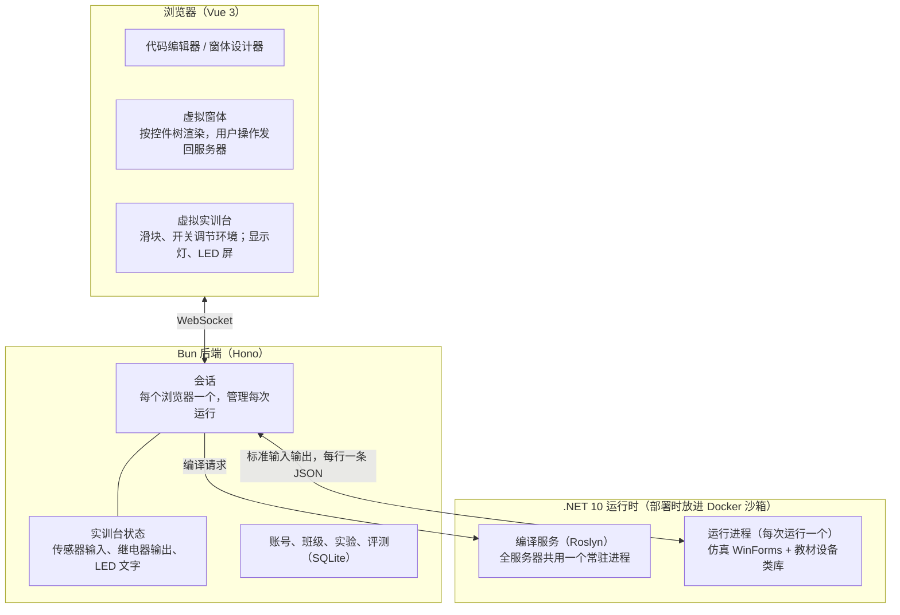
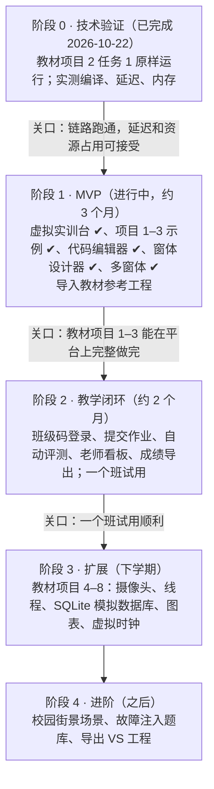

# 物联网 C# 虚拟仿真教学平台设计方案

> 本文件是设计方案的正式版本，随代码一起维护。最初在 Claude Docs 中讨论定稿（2026-10-20），2026-10-22 迁入仓库，并按第 0、1 阶段的实际实现更新。

## 项目定位与教学目标

这是一门面向中职学生的 **C# WinForms 界面与事件编程课**的在线仿真平台，物联网场景是让学生程序"看得见效果"的舞台。

- **学什么**：窗体、控件、属性、事件、Timer、条件判断、方法与类等界面编程知识。核心是"事件驱动"的思维：程序等待事情发生（点按钮、定时器到点、传感器报警），再做出反应。
- **教材**：《物联网编程与应用（第 2 版）》，以智慧校园为主线的 8 个项目。平台兼容教材的设备类库，教材代码原样可运行。
- **不学什么**：通信协议、报文、CRC，以及 ADAM-4150 / 4017+ 等硬件模块的底层细节。
- **效果**：学生写的程序能控制一个生动的智慧校园场景，比如 LED 屏显示文字、路灯亮起、有人闯入报警、烟雾告警，并能实时看到反馈。
- **使用方式**：纯网页，学生不安装任何软件；只给本校使用，同时在线约一两个班。

## 已确定的关键决策

| 事项 | 决定 | 理由 |
| --- | --- | --- |
| 学生编程语言 | C# | 课程要求 |
| 课程方向 | 上位机：WinForms 界面 + 事件 | 教学重点是界面和事件，不是协议 |
| 教材 | 《物联网编程与应用（第 2 版）》及配套资料 | 现用教材 |
| 实验模板与参考答案 | 以书为准，修正书中错误；配套工程只作参考 | 学生手里拿的是书 |
| 评测分工 | 功能项自动评；命名、缩进自动提示；注释和界面美观由老师评；分值由老师设定 | 书上评价表只有指标，没有分值 |
| 设备写法 | 兼容教材类库（DeviceCtrlHelper、Lamp / LED / Alarm 等控件） | 教材代码原样运行，老师不用改教案 |
| 场景 | 智慧校园；先做虚拟实训台（照实训台布局图），校园街景后加 | 和机房实物一一对应 |
| 数据库（项目 6、8） | 用 SQLite 模拟 SQL Server（仿冒 SqlClient） | 不增加服务器负担 |
| 学生是否学协议 | 不学 | 协议只是仿真内部实现 |
| 使用形式 | 纯网页，免安装 | 学生在机房和家里都能用 |
| 学生代码在哪运行 | 服务器（沙箱隔离） | 只供本校一两个班同时使用；原生 .NET 多线程行为真实；浏览器轻量 |
| 前端 | Vue 3 + Naive UI + Chart.js | 开发者熟悉 TypeScript 生态 |
| 后端 | Bun + SQLite | 一人开发，单机足够 |
| 部署 | 公网云服务器 | 需办 ICP 备案 |
| 开发人力 | 一人 | 范围和路线图按此控制 |

## 学生使用体验

页面分为编辑和运行两种模式。编辑模式照着 Visual Studio 来做，学生以后换到真的 VS 上操作一致。

**编辑模式**

- 左侧工具箱：常用控件（Button、Label、TextBox、CheckBox、ComboBox、Timer 等），以及"物联网"分组（教材的 Lamp、LED、Alarm、ShowMsg 等设备控件）。
- 中间「设计」和「代码」两个标签页：设计页拖放控件，窗体下方有组件栏（存放 Timer 和设备组件）；代码页用 Monaco 编辑 `Form1.cs`。
- 右侧属性窗口和事件窗口：双击控件或事件，自动生成处理方法并跳到代码页。
- `Form1.Designer.cs` 由设计器自动生成，可以打开查看。

**运行模式**

- 学生自己的窗体（Windows 风格）和虚拟实训台同时显示在页面上。
- 实训台上可以互动：拖动滑块调节温度、湿度、光照，点击切换人体红外、烟雾、火焰、红外对射，立刻看到学生程序的反应。
- 编译错误和运行异常用中文提示，并标出行号；书上常见的印刷错误（如 `True` 大写）给出针对性提示。

**还原真实行为**：在后台线程里直接修改控件，会抛出和 VS 中按 F5 调试时一样的"线程间操作无效"异常；单选按钮、复选框、下拉框的事件顺序与真实 WinForms 一致。

**教材要求的运行能力**：多窗体（`Show`、`Hide`、`Close`，项目 1 的登录程序就用到）；控制台输出面板（`Console.WriteLine`）；虚拟 COM 口（`SerialPort.GetPortNames()` 返回 COM1–COM5，保留"选串口、点打开"的操作步骤）。

**导入与导出 VS 工程**：设计器能读懂 VS 生成的 `Designer.cs`，教材配套的 19 个参考工程可直接导入，作为初始模板和参考答案；学生作品也能导出为 VS 工程，在机房真机上运行。

## 设备类库设计（兼容教材）

平台提供与教材同名、同签名的仿真类库（API 已从配套 dll 和使用说明中完整整理），教材代码一字不改即可运行。教材自带的仿真版返回随机数；平台的数值由实训台场景控制，联动逻辑可以被确定地验证和评测。

| 对象 | 主要成员 | 平台仿真行为 |
| --- | --- | --- |
| `DeviceCtrlHelper.ledHelper` | `OpenLedCom(串口)`、`SendLedString(文本)` | 成功时原样返回文本，并在实训台 LED 屏上滚动显示；未打开串口返回 `"Error:发送失败"` |
| `adam4017Helper` | `Open(串口)`、`SetData()`、`Close()` | 返回 `ADAM4017ResModel`，温度、湿度、光照、气压、空气质量、CO2、风速为整数字符串，取自实训台滑块 |
| `adam4150Helper` | `Open(串口)`、`SetData()`、`OnOff(DO, 开关)`、`Close()` | `SetData()` 返回人体红外、火焰、烟雾、红外对射四个 bool；`OnOff` 控制报警灯（DO0）、照明灯（DO1）、路灯（DO2）、插座（DO3、DO4） |
| `zigBeeHelper` | `Open(串口)`、`OnOff(继电器, 开关)`、`Close()` | 控制 ZigBee 继电器；节点 1 接实训台照明灯 1（教材项目 3 的路灯） |
| `ipCameraHelper`（未实现） | `Open(IP, 用户, 密码)`、`Start` / `Stop`、`PanUp` / `PanDown` / `PanLeft` / `PanRight`、`ImageRead` 事件 | 在后台线程定时推送画面；云台转动即在全景图上移动取景 |
| 控件 `Lamp` / `Alarm` / `LED` / `ShowMsg` | `OnOff(bool)`、`setLedText(文本)`、`AddText(文本)` | 窗体上的图示控件（自绘图片，尺寸与教材控件一致）；LED 文字滚动。ShowMsg 尚未实现 |

教材代码示例（项目 2 任务 1，向 LED 屏发送信息）：

```csharp
private void btn_Open_Click(object sender, EventArgs e)
{
    DeviceCtrlHelper.ledHelper.OpenLedCom(com_Port.Text);
}

private void btn_Send_Click(object sender, EventArgs e)
{
    string res = DeviceCtrlHelper.ledHelper.SendLedString(txt_SendText.Text);
    if (res.IndexOf("Error") >= 0)
    {
        MessageBox.Show(res);
    }
    else
    {
        led.setLedText(res);
    }
}
```

兼容细节：

- 数值一律返回整数字符串（项目 7 用 `Convert.ToInt16` 转换）。
- 4017 和 4150 允许打开同一个串口；允许重复调用 `Open`。
- 串口没有打开时，`OnOff` 控制无效、返回 false。教材仿真版不检查这一点，平台按实物行为处理：学生忘了"打开"，窗体上的灯会亮而实训台上的灯不亮，正好暴露问题。
- 摄像头事件在非界面线程触发，与真实行为一致。

## 系统架构

学生代码在服务器上编译，并放进单独的进程运行；浏览器只负责显示和交互。三方之间只通过统一格式的 JSON 消息通信（定义见 `shared/protocol.ts`），以后如需改为在浏览器内运行，只替换 `runtime/` 即可。



数据流：

- 学生点"运行"：服务器把工程写到临时目录，编译服务编译出程序集，再启动一个运行进程。
- 学生在窗体上操作：浏览器只上报"用户做了什么"（点击、输入、下拉），由运行进程按真实 WinForms 的顺序触发事件，再把控件属性变化发回浏览器。
- 学生拖动实训台滑块：服务器更新实训台状态，推给运行进程；学生程序的 `SetData()` 直接读本地副本，不需要网络往返。
- 学生程序控制灯和继电器：运行进程报告给服务器，服务器更新实训台状态并推给浏览器。

**目录结构**

```
IOT/
├─ web/        Vue 前端：编辑器、虚拟窗体、虚拟实训台
├─ server/     Bun 后端：示例接口、会话、实训台状态、编译服务和运行进程的调度
├─ runtime/    .NET：仿真 WinForms（Sim.WinForms）、教材设备类库（Sim.Devices）、运行器（Sim.Runner）
├─ shared/     消息协议定义（TS 类型；C# 端对应实现在 Sim.WinForms/Host）
├─ samples/    示例工程，按教材任务整理
└─ docs/       设计方案、教材逐任务摘要
```

## 技术栈

网站主体用 TypeScript；只有编译和运行学生 C# 代码的部分用 .NET。标"计划"的尚未引入。

| 层 | 用途 | 选择 |
| --- | --- | --- |
| 前端 | 框架 | Vue 3 + TypeScript + Vite |
| 前端 | 状态管理 / 路由 | 计划：Pinia / Vue Router |
| 前端 | 组件库（网站外壳） | Naive UI |
| 前端 | 代码编辑器 | Monaco Editor |
| 前端 | 窗体设计器、虚拟 WinForms 控件 | 自研（Vue 组件 + CSS，外观模仿 Windows） |
| 前端 | 虚拟实训台场景 | HTML + CSS 动画 |
| 前端 | 图表 | 计划：Chart.js |
| 前端 | 实时通信 | 浏览器原生 WebSocket |
| 后端 | 运行时 | Bun |
| 后端 | Web 框架 | Hono |
| 后端 | 数据库 | 计划：SQLite（`bun:sqlite`）+ Drizzle ORM |
| 后端 | 登录 | 计划：Cookie 会话 + `Bun.password` |
| 后端 | 参数校验 | 计划：Zod |
| C# 运行时 | 平台 | .NET 10 LTS |
| C# 运行时 | 编译 | Roslyn，常驻编译服务，内存编译，中文报错；计划：编译时改写旧版线程 API |
| C# 运行时 | 运行器 | .NET 控制台程序，模拟界面线程和消息循环 |
| C# 运行时 | 仿真类库 | 自研：`System.Windows.Forms` 子集 + 教材设备类库 + `Font` 等少量 System.Drawing 类型 |
| C# 运行时 | 数据库仿真 | 计划：仿冒 `System.Data.SqlClient`，底层 Microsoft.Data.Sqlite；T-SQL 用 ScriptDom 解析后转写 |
| C# 运行时 | 图片编解码（如需） | 计划：SkiaSharp |
| C# 运行时 | 代码补全 | 计划：Roslyn `CompletionService` |
| 工程 | 仓库 | Bun workspaces 单仓库 |
| 工程 | 测试 | `bun test`（端到端、单元、压力测试）；计划：用教材参考工程做回归测试、Playwright |
| 部署 | 服务器 | 一台 Linux 云服务器，4 核 8 GB 起步 |
| 部署 | 沙箱 | 计划：Docker（断网、只读、限制资源） |
| 部署 | HTTPS / 静态文件 | 计划：Caddy |
| 部署 | 进程管理 | 计划：Docker Compose |
| 部署 | 备份 | 计划：定时 `sqlite3 .backup` + 异地拷贝 |

## 安全与服务器资源

在公网上运行学生代码，必须做三层防护；第 0 阶段实测，100 个学生程序同时运行合计约 1.1 GB 内存。

**安全措施**（部署前完成）

1. **沙箱隔离**：每次运行放进 Docker 容器，禁止联网、文件系统只读，限制内存（如 128 MB）、CPU、进程数和运行时长。
2. **编译时白名单**：只允许使用白名单内的命名空间；用到文件读写、`Process`、反射等时，直接给出中文报错。
3. **账号管控**：不开放自由注册，由老师用班级码或批量导入创建账号。

**资源估算**

- 编译器做成常驻进程，全服务器共用一个，约占 150 MB；学生程序运行时不加载编译器。
- 每个运行中的学生程序平均约 11 MB（按 PSS 计，共享的 .NET 运行库按进程数平摊；单看 RSS 约 47 MB）。
- 每个学生同时只运行一个程序，闲置超时自动结束。
- 两个班约 100 人同时运行，合计约 1.3 GB；4 核 8 GB 的服务器有充足余量。加上 Docker 沙箱后需要复测。
- SQLite 开启 WAL 模式，定时备份。

## 实验规划

实验直接对应教材的 8 个项目，平台按项目顺序逐步补齐所需能力。下表依据配套 PPT、19 个参考工程和整本教材整理；项目 1–3 只需约 10 种控件、不涉及线程和数据库。

| 项目 | 教材内容 | 平台需要支持 | 状态 |
| --- | --- | --- | --- |
| 1 C# 入门基础 | 登录与新增用户（两个窗体）、计算器、继承与多态演示 | 多窗体、Label、TextBox（PasswordChar）、Button、ComboBox、MessageBox、控制台输出 | 任务 1 已完成，任务 2 示例待整理 |
| 2 环境监测 | LED 屏推送文字；4017 采集温湿度和光照；采集后推送 LED | LED 控件、ledHelper、adam4017Helper、GroupBox、虚拟 COM 口 | 已完成 |
| 3 智慧路灯 | ZigBee 开关路灯；人体红外每 5 秒检测并联动路灯 | Lamp 控件、zigBeeHelper、adam4150Helper、CheckBox、RadioButton、Timer | 已完成 |
| 4 入侵监测 | 红外对射检测；网络摄像机画面与云台；报警灯 | PictureBox、摄像头仿真、Alarm 控件、图片保存 | |
| 5 灾情监测 | 火焰（Timer）、烟雾（Thread）、灾情记录与推送 | Thread（含 Suspend / Resume / Abort）、跨线程改界面、ListBox、FormClosing | |
| 6 数据存储 | 建库建表、采集入库与增删改、按时间段查询 | SQL 窗口（代替 SSMS）、SqlClient 仿冒（SQLite）、DataGridView、DateTimePicker | |
| 7 情景控制 | 智慧教室、寝室、会议室三种情景联动 | TrackBar、资源图片、PictureBox 当按钮、mp3 播放、虚拟时钟 | |
| 8 管理平台 | 主界面、校园环境（自动控制、7 天温度图表）、校园安防（抓拍入库、历史图片） | Panel Dock、无边框窗体、透明背景、Chart、ShowDialog、图片存数据库 | |

每个实验以数据形式存放（目前在 `samples/`，以后迁到 `content/`），由以下部分组成：

- **任务说明**：对应书上的任务描述和步骤，控件名以书为准。
- **参考答案**：修正后的书本代码（修正编译错误和逻辑错误，如 INSERT 列错位、漏写 `new DataSet()`、项目 7 开灯判断写反）。
- **常见错误提示**：学生照抄书上的错误（如 `True` / `False` 大写、`Catch(EventArgs ex)`）时给出针对性中文提示。
- **评测规则**：书上评价表的功能项转为自动检查，如"把光照调到 300，2 秒内照明灯应打开"。
- **扩展练习**：书上"边想边做"和"自主探究"约 30 道，其中十余道是填空代码题，可直接做成填空练习。
- **场景配置**：初始环境值、传感器与通道的对应关系、虚拟时钟起始时刻、预置数据表和样例数据。

老师不写代码也能修改或新增实验。

## 开发路线图

各阶段时长按一人兼职估算，会随实际进度调整。



并行事项：尽早办理 ICP 备案（需数周）。

**第 0 阶段结果（2026-10-22，已完成）**：教材项目 2 任务 1 的书上代码一字未改，在网页中完整运行：选串口、打开、推送文字到 LED 屏，未打开串口时弹出 "Error:发送失败"。本机实测（16 核、28 GB）：

| 指标 | 结果 |
| --- | --- |
| 编译（编译服务预热后） | 10–300 ms |
| 点"运行"到窗体出现 | 约 100 ms |
| 单次操作往返 | 约 15 ms |
| 100 个程序同时运行 | 合计约 1.1 GB，平均每个 11 MB，另加编译服务约 150 MB |
| 100 个程序同时点击 | 往返中位数约 60 ms，P95 约 75 ms |

验证中的调整：第一版每个运行进程都加载 Roslyn，单个约 170 MB；改为常驻编译服务后，运行进程不再加载编译器，编译也从约 0.9 s 降到几十毫秒。沙箱尚未接入，以上数字需在接入 Docker 后复测。

**第 1 阶段进展**：

- 2026-10-22：虚拟实训台（服务器统一保存状态，网页调节环境）；CheckBox、RadioButton、Lamp、Alarm；教材项目 2、3 共 5 个任务的示例全部跑通。
- 2026-10-22：代码编辑器换成 Monaco：C# 语法高亮；编译错误以波浪线标在代码里，点错误信息跳到对应行；F5 运行、Shift+F5 停止（在整个页面生效，并阻止浏览器 F5 刷新）；改过的代码自动保存在浏览器本地，可一键恢复原始代码。前端打包后 JS + CSS 压缩约 1.2 MB。
- 2026-10-22：窗体设计器：工具箱拖放或双击添加控件，选中、拖动、改大小、拖进拖出分组框，Delete 删除、方向键微调；属性窗口和事件窗口；双击控件或事件生成事件处理方法并跳到代码；Timer 等组件显示在组件栏。Designer.cs 在浏览器端直接解析和生成：未改动的语句保留原文，教材 25 个参考窗体和全部示例读入再写出逐字节不变；布局语句（SuspendLayout / ResumeLayout / PerformLayout）的增删规则与 VS 一致。
- 2026-10-22：设计器撤销 / 重做（撤销"生成事件处理方法"时连同插入的方法一起撤掉，不覆盖学生已写的代码）；工具箱、属性、事件窗口全部显示中文，英文名放在悬停提示里；支持中文的控件名和类名。
- 2026-10-22：多窗体：新建窗体（与 VS 新建窗体相同的两个文件，沿用工程命名空间）、删除窗体（启动窗体不能删）；标签页按窗体分组；运行时点哪个窗口哪个到最前。新增示例：项目 1 任务 1 登录与增加用户（两个窗体的 Designer.cs 由设计器引擎生成）。

## 技术风险与待确认事项

最大的风险是仿真 WinForms 的覆盖面和交互流畅度；交互流畅度已在第 0 阶段验证。

| 风险 | 担心什么 | 应对 |
| --- | --- | --- |
| 仿真 WinForms 工作量 | 项目 4–8 需要的控件和窗体特性较多 | 按项目逐步实现；项目 1–3 只需约 10 种控件 |
| 事件顺序保真 | 书上代码依赖真实 WinForms 的事件顺序：单选按钮先触发"取消选中"再触发"选中"，ComboBox 的 Click 先于展开，CheckBox 的 Click 时 Checked 已切换 | 逐项对照真实行为实现，并用书上代码做回归测试（单选、复选、下拉已实现并有测试） |
| 书与配套不一致 | 控件名、步骤在书、表格和配套工程之间经常不同，书上代码有编译错误 | 以书为准逐任务整理模板和修正版答案 |
| T-SQL 转 SQLite | 教材用 SQL Server 写法（`TOP`、`CONVERT`、DataAdapter 回写、日期字符串） | 用 ScriptDom 解析后转写；连接串一律指向学生自己的 SQLite 库；日期统一存为标准格式；以教材全部 SQL 语句为测试集 |
| 旧版线程 API | `Thread.Suspend` / `Resume` / `Abort` 在新版 .NET 上会报错 | 编译时替换为平台实现的可暂停线程 |
| 图片处理 | System.Drawing 在 Linux 上不受支持 | 自实现 `Image` / `Bitmap` 等少量类型，只传递和保存图片 |
| 时间相关逻辑 | 项目 3 起就有按时刻开关灯的练习，部分定时器间隔长达 2 小时 | 提供可调、可加速的虚拟时钟 |
| 事件延迟 | 浏览器和服务器之间来回传递事件，点击是否有卡顿感 | 已实测：单次约 15 ms，100 个程序同时操作中位数约 60 ms |
| 并发资源 | 100 个程序同时运行时的内存和 CPU | 已压测：100 个程序合计约 1.1 GB；闲置超时回收 |
| 公网安全 | 恶意或无意的危险代码 | 沙箱 + 白名单 + 账号管控 |
| ICP 备案 | 办理需要数周 | 尽早启动 |

**待确认**

- [ ] 串口是否要求接对：目前学生选任意 COM 口都能控制设备；是否在部分实验中要求按实训台接线（COM2 4017、COM3 4150、COM4 ZigBee、COM5 LED）
- [ ] 虚拟实训台的画面细节（目前为第一版）
- [x] 第一个场景：智慧校园（和教材一致）
- [x] 设备写法：兼容教材类库
- [x] 数据库：教材用 SQL Server 2008 R2，平台用 SQLite 模拟
- [x] 项目 5 的推送方式：推送到 LED 屏
